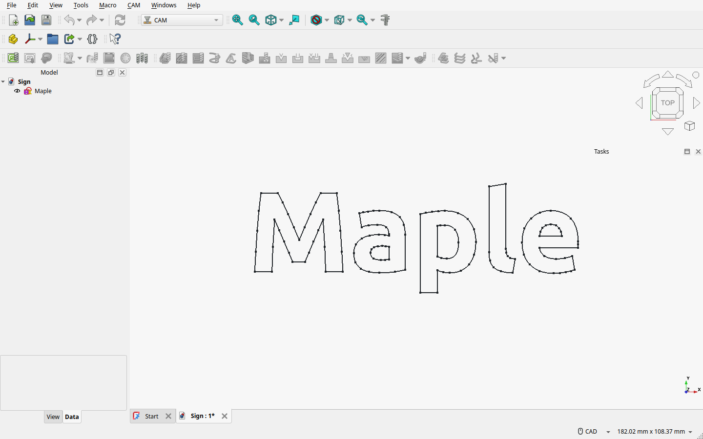
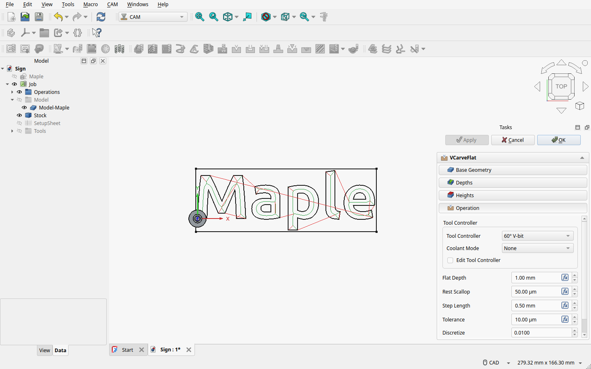
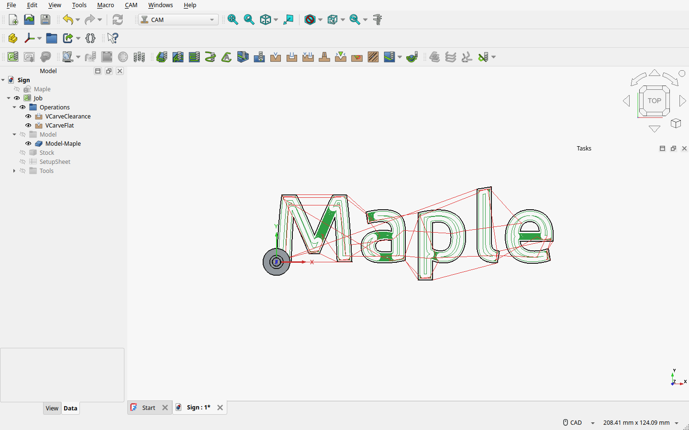
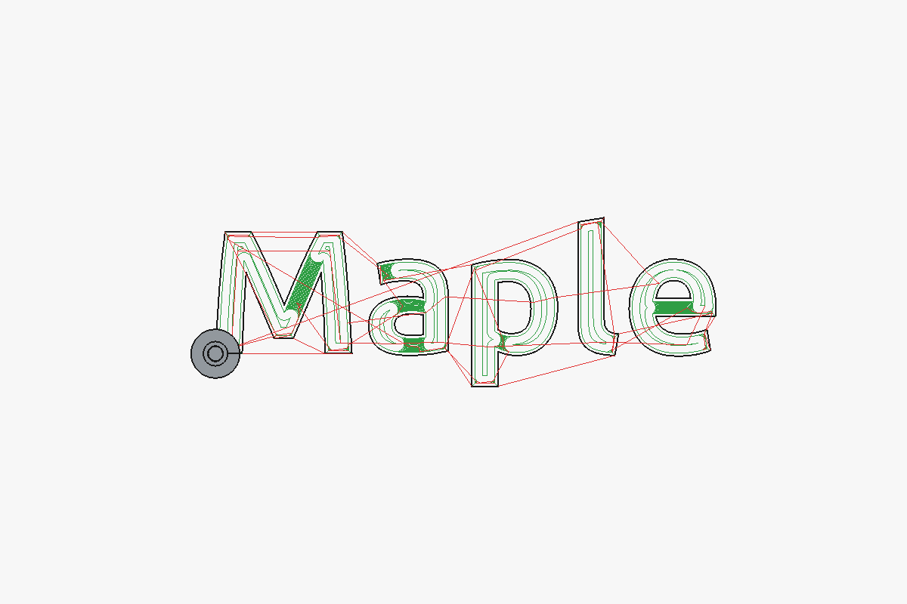
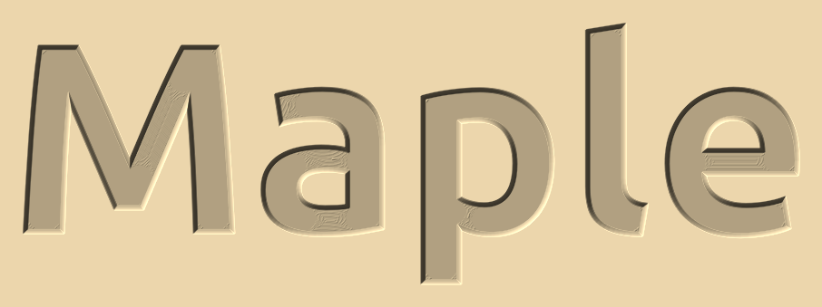

# Getting started: carve a word

This walk-through carves the word "Maple" 1 mm deep into a board, with sharp letter corners and a flat floor.
It takes about ten minutes. You need the addon [installed](Installation.md) and two tools: a **V-bit**
(here 60°, tip 0.1 mm) and a small **end mill** (here 3.175 mm, 1/8").

## 1. Draw the text as a sketch

1. Switch to the **Draft** workbench and create a **ShapeString** (Annotation → Shape from text): text
   `Maple`, height 25 mm, a bold font.
2. With the ShapeString selected, run **Modification → Draft to Sketch** (it converts to a sketch).
3. Delete or hide the ShapeString; keep the sketch.

Any closed sketch works the same way: drawn in the Sketcher, imported from an SVG (File → Import), or made
from other Draft objects.

> **Letters must not touch.** A sketch's outlines may lie inside each other (the counter of an "a") but must
> not cross or touch. Script fonts often join their letters; pick a font with separate letters or put touching
> letters in separate sketches.

## 2. Create a CAM Job with two tool controllers

1. Switch to the **CAM** workbench, select the sketch and create a **Job** (CAM → Job). Set the stock in the
   Job's Setup tab to your board.
2. In the Job's **Tools** tab add a tool controller for the V-bit and one for the end mill. Set their feeds and
   spindle speeds as for any CAM operation.

## 3. V-Carve Pair

Select the sketch's clone in the Job (under *Model*) and press **V-Carve Pair**
(). It creates a clearance op with the end mill and a
V-carve op with the V-bit, linked together, and opens the V-carve op's task panel. Set **Flat Depth** to 1 mm:

Press **OK**. The Job now has both ops, the clearance op first:

## 4. Look at the toolpaths

The end mill clears the wide, flat parts of the letters. The V-bit cuts every wall from the surface down to the
floor, runs into each inner corner so it stays sharp, and clears what the end mill could not reach (the narrow
parts and corners).

To see the result before cutting, run the CAM **Simulator** on the Job. The picture below is rendered from the
two toolpaths with the addon's own cut simulation, as the board will look:

## 5. Make the G-code

Post-process the Job as usual (CAM → Post Process). Cut the clearance op first, change to the V-bit, then cut
the V-carve op: zero Z on the board's top for both tools.

## Next

- [V-Carve Flat and Clearance](V-Carve-Flat.md): what each property does, rest machining with a second end mill.
- [Inlays](Inlays.md): carve the same sketch as a pocket and a plug of another wood.
- [Photo V-carving](Photo-V-Carving.md): carve a picture.
