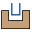
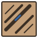

# V-Carve Flat user guide

V-Carve Flat is a FreeCAD CAM addon for V-carving: signs and lettering with a flat floor, V-carve inlays,
and photos carved as grooves. It adds its operations to FreeCAD's CAM workbench, so the toolpaths go
through the usual Jobs, tool controllers, simulator and post processors.

## Pages

1. **[Installation](Installation.md)**: install the addon and check that it loaded.
2. **[Getting started](Getting-Started.md)**: carve a word into a board, step by step.
3. **[V-Carve Flat and Clearance](V-Carve-Flat.md)**: how flat depth, clearance and rest machining work,
   with every property.
4. **[Inlays](Inlays.md)**: a pocket and a matching plug, and the fit check.
5. **[Photo V-carving](Photo-V-Carving.md)**: a picture as grooves whose depth follows its darkness.
6. **[Troubleshooting](Troubleshooting.md)**: messages, common mistakes and known limitations.

## What it does

| Command | What it makes |
|---|---|
|  **V-Carve Flat** | The V-bit operation: sharp walls, and a flat floor at `FlatDepth` |
|  **V-Carve Clearance** | The end-mill operation that clears the flat floor |
|  **V-Carve Pair** | Both of the above, linked, in one step |
|  **V-Carve Plug** | The mirrored plug of a V-carve pocket (normally made by V-Carve Inlay) |
|  **V-Carve Inlay** | Two new Jobs: a pocket and its matching plug |
|  **Check Inlay Fit** | Marks where the seated plug would collide (red) or leave a void (blue) |
|  **V-Carve Photo** | Grooves whose depth follows an image's darkness |

## About

V-Carve Flat is free software under the LGPL-2.1-or-later, written by alf and Claude (Anthropic). It is a
clean-room implementation, inspired by F-Engrave and commercial V-carving tools; no code was copied from
them. Source, releases and issues: <https://github.com/ghbalf/freecad-vcarve>.
