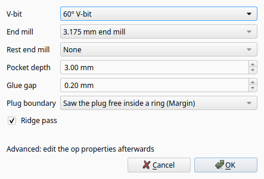
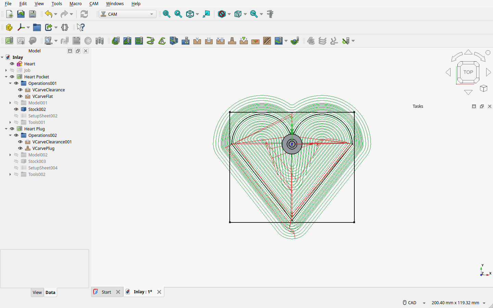
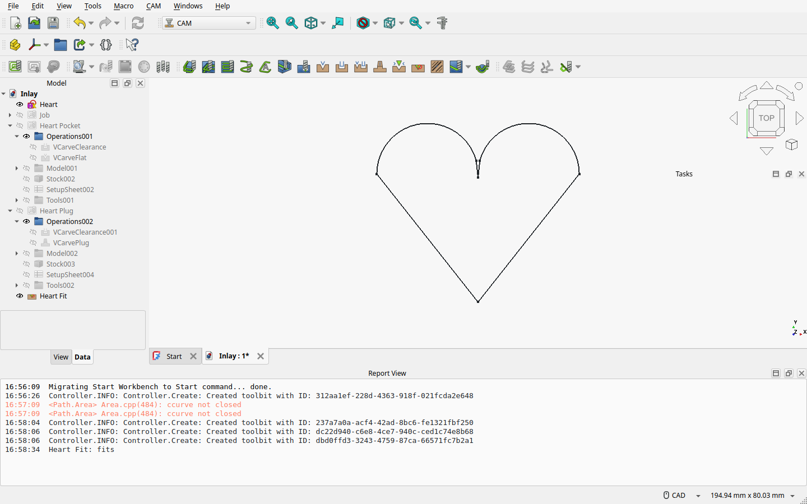

# Inlays

A V-carve inlay sets one wood into another: the design is carved as a **pocket** into the base board and as
a raised, mirrored **plug** into a contrasting board. The plug is glued upside down into the pocket, and
once the glue has set the plug board is sawn off and planed flush. Because both parts are cut with the same
V-bit, their walls match at any depth, and the corners stay sharp.

## Example: a heart

The example is a 60 mm heart sketch in a Job with a 60° V-bit (tip 0.1 mm) and a 3.175 mm end mill. Its two
arcs end 4 mm up and meet in a small V notch rather than in a cusp (see below). Any closed sketch works;
text works too.

> **No cusps.** Where two curves meet along one tangent (a heart drawn from two half circles touching at the
> top), the pocket's wall comes to a point of zero width that no V-bit reaches, while the plug's cone fills
> it: the fit check reports a collision of about 1 mm there. Draw a small V notch or a short straight
> instead.

### 1. Run V-Carve Inlay

Select the sketch (or its clone in the Job) and run **V-Carve Inlay**. The dialog takes the tool
controllers from the sketch's Job:

| Field | Meaning |
|---|---|
| **V-bit**, **End mill** | The tool controllers to use. Pocket and plug are cut with the same V-bit |
| **Rest end mill** | Optional, *None* by default: a smaller end mill that clears what the end mill left, as a `RestOnly` clearance op in both Jobs |
| **Pocket depth** P | Depth of the pocket's flat floor. Default: 60 % of the V-bit's cone height, at most 3 mm |
| **Glue gap** G | Space left between the plug's top and the pocket floor for glue. Default 0.2 mm |
| **Plug boundary** | *Margin*: clear a ring around the plug, then saw it free. *Stock*: clear the whole plug board (takes longer) |
| **Ridge pass** | Flatten the plug's narrow ridges where a flat-tipped V-bit would leave a sharp apex (see below) |

OK creates two new Jobs, each with its own copies of the tool controllers. Your original Job is not
changed.

- **"Heart Pocket"** has your Job's stock settings and a V-Carve Pair with `FlatDepth` = P.
- **"Heart Plug"** has a V-Carve Plug op and its clearance op. The plug op carves the mirrored design
  as a raised plug.

### 2. Check the fit

Select the plug op (or either Job) and run **Check Inlay Fit**. It simulates the plug seated in the pocket,
flipped as you would glue it, from the G1 moves of all four ops, and creates a "Heart Fit" object just
above the pocket:

- **red** where the plug collides with the board (the seated gap is below −0.02 mm, so it would not seat);
- **blue** where a void is left (a gap wider than the glue gap by more than 0.1 mm).

The summary goes to the report view:

The Fit object does not update itself: when the toolpaths change it marks itself "outdated: run Check
Inlay Fit". The simulation grid is 0.25 mm, so features smaller than that can be missed.

### 3. Cut, glue, saw

1. Cut the pocket Job in the base board.
2. Cut the plug Job in the plug board (see the next section for its Z zero).
3. Glue the plug upside down into the pocket and clamp it. It seats at the glue gap G above the pocket floor.
4. Saw off the plug board, leaving a little over the base board's surface, and plane or sand it flush.

## Stock and Z zero

The plug is carved at depth P − G + S below the plug board's top, where S is the `SurfaceGap`: seated, the
plug's cut floor stays S above the base board's surface, so there is material to saw through.
`PlugStartDepth` shows P − G.

- **Zero Z on the real top of the plug board, carefully:** an error of e changes the plug's height, and
  with it the glue gap, by e. Zeroed too low, the plug collides.
- The plug Job's stock starts as thick as your Job's stock, or 1 mm deeper than P − G + S if that board
  is too thin. **Set it to the real plug board** afterwards; the plug op warns when the stock is thinner
  than P − G + S.
- In *Stock* mode the end mill clears out to the stock's edge, so the stock must reach past the plug's
  outline by at least the end mill's diameter. FreeCAD's default 1 mm stock margins are narrower: set the
  plug Job's stock to the real board size. The op warns otherwise.

## Flat tips and the ridge pass

A V-bit with a flat tip cuts narrow pocket grooves with a flat bottom, but the plug's ridge for that stroke
would come to a sharp apex, land on that flat bottom and lift the plug. The **ridge pass** (on by default)
cuts each plug ridge flat where it is narrower than the tip. It runs once after the plug's last level and
makes no path for a pointed bit. It leaves small gaps at convex corners, which the glue fills.

The flat tip also cannot reach into a sharp, narrow inner corner of the plug's cut area, such as the mirrored
tip of a letter's counter. It leaves a sliver of a few hundredths of a millimetre that the glue gap almost
entirely absorbs; the fit check may show it as a tiny red mark. **Pointed V-bits are best for inlays.**

Narrow strokes, narrower than 2·(r_t + P·tan(half angle)) with r_t the tip radius, get a V bottom in the
pocket and no floor gap: the plug's ridge lands on it whatever G is. G protects only the wide, flat areas.

**Rounded tips.** FreeCAD's V-bit has only a flat tip. For a rounded tip, enter as Tip Diameter the width
where the rounding meets the cone. Errors are then gaps, never collisions.

## Plug properties

V-Carve Plug (group "V-Carve Plug"):

| Property | Default | Meaning |
|---|---|---|
| `PocketOp` | set by V-Carve Inlay | The pocket's V-Carve Flat op (sketches, P and V-bit come from it) |
| `GlueGap` | 0.2 mm | Gap between plug top and pocket floor when seated |
| `SurfaceGap` | min(1.5 mm, cone height − (P − G)) | Gap between the plug board and the base board's surface when seated |
| `RidgePass` | on | Flatten the plug's narrow ridges for a tipped V-bit |
| `PlugMargin` | 10 mm | Margin mode: width of the flat ring cleared around the plug (counters are cleared whole) |
| `PlugBoundary` | Margin | Margin: a ring around the plug; Stock: the whole stock of the plug Job |
| `MirrorAxis` | X | X flips left-right, Y flips front-back, about the design's bounding-box centre |
| `PlugStartDepth` | read-only | P − G |

The plug Job's model shows the design unmirrored; the op mirrors it when it makes the path. V-Carve Inlay
sets a 1.5 mm step-down on all four ops.
