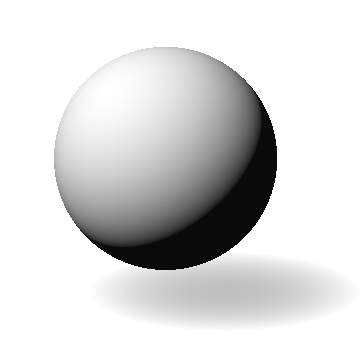
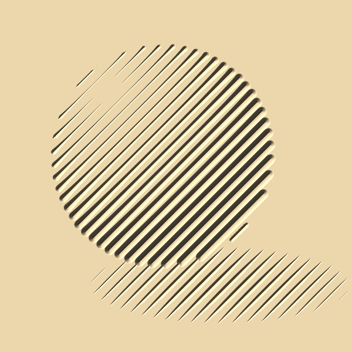
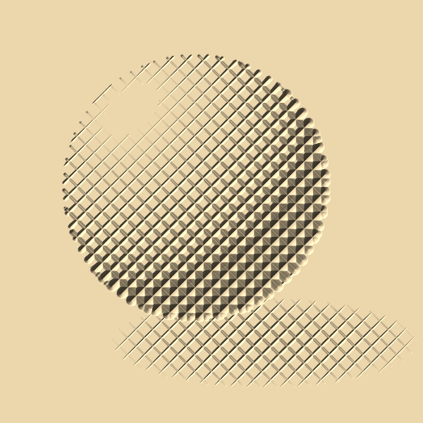
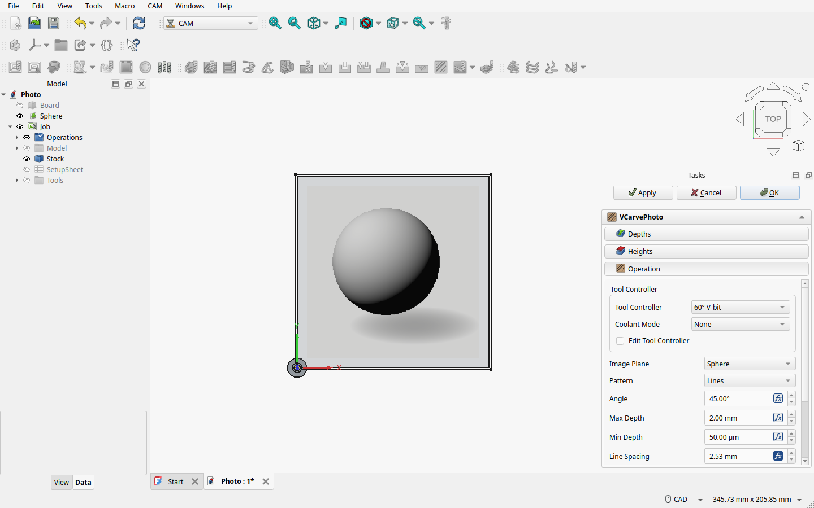
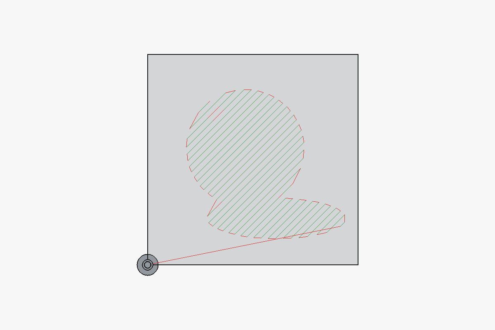

# Photo V-carving

**V-Carve Photo** carves a picture as V-grooves: dark areas get deep, wide grooves, light areas shallow ones or
none. Seen from a distance, the grooves' shadows reproduce the picture. It suits light, close-grained
hardwood such as maple, lit from the side.

| The image | Lines (rendered from the toolpath) | Hatch |
|---|---|---|
|  |  |  |

## Example: a lit sphere

The example carves a 90 × 90 mm image into a 100 × 100 × 12 mm board with a 60° V-bit (tip 0.1 mm).

### 1. Prepare the image

Do this in GIMP or any image editor before importing:

- **Grey.** Colour images are converted to grey (0.299 R + 0.587 G + 0.114 B), but converting yourself
  lets you decide which colours become dark.
- **Contrast.** Raise it: the carving shows fewer grey levels than a screen.
- **Background.** Paint what should stay uncut pure white. Transparent pixels stay uncut too.
- **Size.** About one pixel per 0.25 mm (`SampleStep`) is enough; finer pixels are averaged.

### 2. Import it as an image plane

**File → Import**, choose the image and *Image plane*. Set the plane's size (`XSize`, `YSize`) and place it
over the stock, flat in the XY plane. It is carved as the **top view** shows it, so a plane turned face down
gives a mirrored carving. Only the part over the stock is carved; the op warns when the image reaches past
it.

### 3. Create the Job and the op

Create a CAM Job for the board with a V-bit tool controller. Select the image plane and run
**V-Carve Photo**. (With a single image plane in the document it is picked anyway; otherwise pick it in
the task panel.)

The defaults carve black 2 mm deep, with the lines just far enough apart that the deepest grooves do not
merge. Press OK. The toolpath, from above:

### 4. Facing the board first?

If a MillFace op flattens the board before the photo, the photo must start at the faced surface: set its
`StartDepth` there (it defaults to the stock top). The op warns when a MillFace before it faces deeper than
its `StartDepth`. Note that MillFace needs a face picked under *Base Geometry*: a Job whose model is only a
sketch or an image needs a solid for the board (for example a Part Cube) whose top face you pick.

## How the depth follows the image

Each groove is cut at depth = darkness × `MaxDepth`, where darkness is 0 for white and 1 for black on a linear
(not sRGB) light scale, so black always reaches `MaxDepth`. Mid-greys therefore carve deeper than they look:
sRGB 128 is 22 % of white's light and carves at 78 % of `MaxDepth`. Lighten the image if it carves too
dark. `Contrast` stretches the tones around mid-grey
first and `Invert` swaps dark and light. Where the depth is under `MinDepth` the bit lifts out.

A groove at depth d is tip + 2·d·tan(half angle) wide. **Line Spacing** defaults to the groove width at
`MaxDepth` plus 5 %, as an expression, so it follows `MaxDepth` (also live in the task panel). Picking a
V-bit fills it in anew. To set your own spacing, clear the expression with the f(x) button in the property
editor. When grooves at `MaxDepth` are wider than the spacing they merge into a flat dark area, and the op
warns.

## Patterns

- **Lines**: parallel lines at `Angle` (45° by default).
- **Hatch**: two crossed line sets, at `Angle` and `HatchAngle`. Each set cuts 1 − √(1 − darkness) of the
  depth, so that the two together cover the same share of the surface as one Lines set would.
- **Custom**: the edges of the `Vectors` objects instead of straight lines, for example contour lines or a
  spiral drawn in Inkscape. Save them as SVG, File → Import the SVG, select the imported objects and press
  *Add selected* in the task panel. Sketches work too. The image still sets the depth along them.

## Getting a good result

- **Bits.** A narrower V-bit (30°, 45°) gives narrower grooves, so the lines can lie closer and show more
  detail at the same depth.
- **Depth.** 1.5–2.5 mm. Deeper means more contrast and wider grooves, and so wider spacing.
- **Eyes.** A portrait lives or dies by its eyes. Make the pupil fully black and leave a pure-white catchlight
  in it, at least a groove width across, so the bit lifts out there. For finer detail trace the eye's outlines
  in Inkscape and carve them in a second op with the Custom pattern.
- **`BandAverage`.** By default each groove follows the image along its line. With `BandAverage` on it follows
  the image averaged across the band between its neighbours: truer tones, and thin details between lines
  show, but a highlight smaller than the spacing fades.
- **Try it first** in the CAM simulator, or on a scrap of the same wood.

## Properties

V-Carve Photo (group "V-Carve Photo"):

| Property | Default | Meaning |
|---|---|---|
| `ImagePlane` | picked in the panel | The image plane to carve |
| `Pattern` | Lines | Lines, Hatch or Custom |
| `Vectors` | none | Objects whose edges are carved (Custom) |
| `Angle` | 45° | Direction of the lines, from the X axis |
| `HatchAngle` | 135° | Direction of the second line set (Hatch) |
| `LineSpacing` | groove width at `MaxDepth` × 1.05, as an expression | Distance between lines |
| `MaxDepth` | 2 mm | Depth of black below Start Depth; capped at the V-bit's cone height |
| `MinDepth` | 0.05 mm | Shallower than this, the bit lifts out |
| `SampleStep` | 0.25 mm | Distance between depth samples along a line; finer pixels are averaged |
| `Contrast` | 100 % | Contrast around mid-grey; above 100 % strengthens it |
| `Invert` | off | Swap dark and light |
| `BandAverage` | off | Lines and Hatch: follow the image averaged over each line's band |
| `Tolerance` | 0.01 mm | Simplification tolerance of the toolpath |
