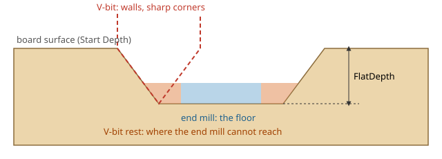

# V-Carve Flat and Clearance

A plain V-carve (FreeCAD's own Vcarve op) cuts every part of a design as deep as the V-bit's cone
reaches there: narrow strokes shallow, wide areas deep. Wide letters then need a huge bit or stay uncut in
the middle. V-Carve Flat stops at a chosen depth instead and leaves a **flat floor** there, which an
**end mill** clears quickly. The V-bit still cuts the walls, so the corners stay sharp.

## The two operations

**V-Carve Flat** (V-bit) cuts:
- the walls of every outline, from the surface down to `FlatDepth`, sharp into inner corners;
- strokes narrower than the flat floor along their centre line, as deep as the cone allows there;
- the **rest** of the floor: the parts the end mill cannot reach, such as corners and narrow areas.

**V-Carve Clearance** (end mill) clears the flat floor of the V-Carve Flat op that its `VCarveOp`
property links to, with an offset or zigzag pocket pattern.

**V-Carve Pair** creates both, linked, and opens the V-Carve Flat op's task panel: the usual way to start.
With no clearance op the V-bit clears the whole floor itself, which works but is slow; a warning says so.

## Selecting what to carve

- Select a **whole sketch** to carve all of it, or several sketches.
- Select **edges** to carve only the outlines they belong to: an edge picks its whole closed outline, and
  holes (letter counters) count only if their edges are selected too.
- The sketches must belong to the Job's model (the clones in the Job, or the originals the Job was made
  from).
- A sketch's outlines must not cross or touch each other; an outline inside another (the counter of an
  "O") is fine.

## Flat depth

`FlatDepth` is the floor's depth below Start Depth (normally the stock top).

- `FlatDepth` = 0: no floor. The V-bit carves as deep as its cone allows, like a plain V-carve; areas
  wider than the cone stay uncut in the middle and a warning says so.
- A flat depth deeper than the V-bit's cone height is capped, with a warning.
- Deeper floors are cut in steps of the op's Step Down; the clearance op follows the V-carve op's levels.

## Sharp corners

The V-bit's wall pass runs into each inner corner of the floor outline instead of rounding it, so the
corner stays sharp from the surface down to the floor. The floor's own corners keep the V-bit tip's small
radius. A pointed V-bit (tip 0) gives the crispest result.

## Rest machining with several end mills

All active clearance ops linked to one V-Carve Flat op form a **chain**, in the Job's order:

1. The first clearance op clears the floor with a large end mill.
2. A following clearance op with `RestOnly` on and a **smaller** end mill clears only what the ops before
   it left: corners and narrow areas.
3. The V-bit cleans up what is left (scallops up to `RestScallop`).

Changing an end mill, `Allowance`, `Active`, the link or the order of the clearance ops updates the V-bit's
rest area on the next recompute.

## Properties

V-Carve Flat (group "V-Carve"):

| Property | Default | Meaning |
|---|---|---|
| `BaseShapes` | empty | Whole sketches to carve (edge selections go to the standard `Base`) |
| `FlatDepth` | 0 mm | Depth of the flat floor below Start Depth (0 = as deep as the V-bit cone allows) |
| `RestScallop` | 0.05 mm | Scallop height allowed where the V-bit clears floor the end mill cannot reach |
| `StepLength` | 0.5 mm | Sampling distance along the medial axis |
| `Tolerance` | 0.01 mm | Simplification tolerance of the toolpath |
| `Discretize` | 0.01 | Deflection used to discretize curves |
| `Colinear` | 10 | Angle (degrees) below which medial-axis segments count as colinear |

V-Carve Clearance (group "V-Carve"):

| Property | Default | Meaning |
|---|---|---|
| `VCarveOp` | none | The V-Carve Flat op whose floor is cleared (V-Carve Pair sets it) |
| `PocketPattern` | Offset | Clearing pattern: Offset or ZigZag |
| `StepOver` | 40 % | Stepover as a percentage of the end mill diameter |
| `Allowance` | 0 mm | Distance kept from the floor's edge |
| `RestOnly` | off | Clear only what the earlier clearance ops of the same V-carve op left; warns when its end mill is not smaller than theirs |

Depths, heights, feeds and the tool controller work as in any CAM operation.

## Tips

- **Choosing the flat depth.** Deep enough for the letters to read, shallow enough for the V-bit's cone:
  1–3 mm is typical for signs. The V-bit must reach `FlatDepth`: its cone height is
  (diameter − tip) / 2 / tan(half angle).
- **Choosing the end mill.** As large as fits the wide parts of the floor; add a smaller `RestOnly` end
  mill if the V-bit has much rest area to clear.
- **Order in the Job.** Clearance first, then the V-bit, as V-Carve Pair arranges them: the V-bit then
  cuts the walls cleanly and only the corners the end mill left.
